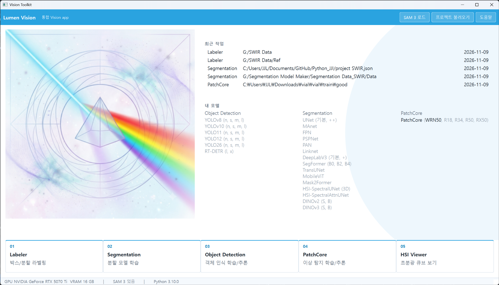
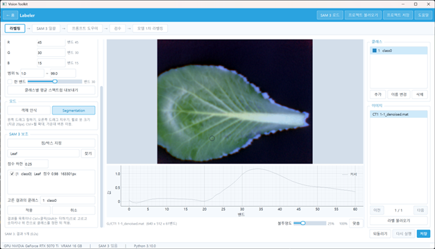
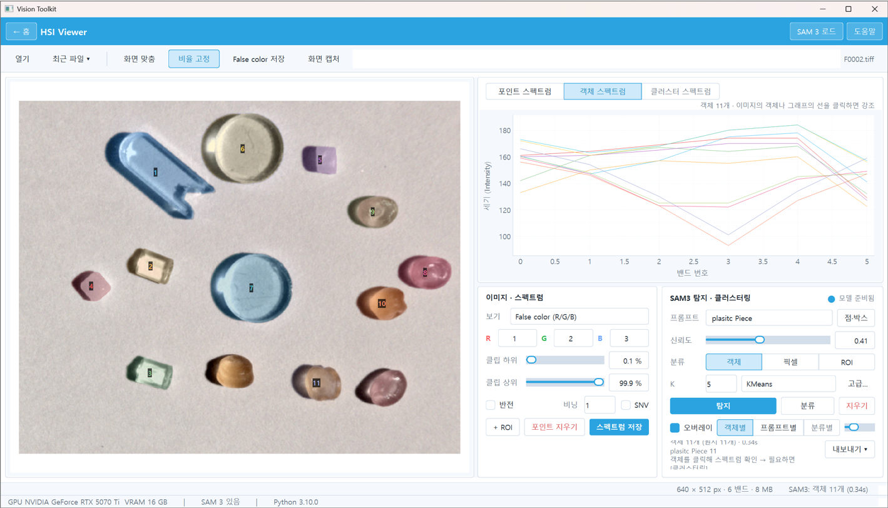
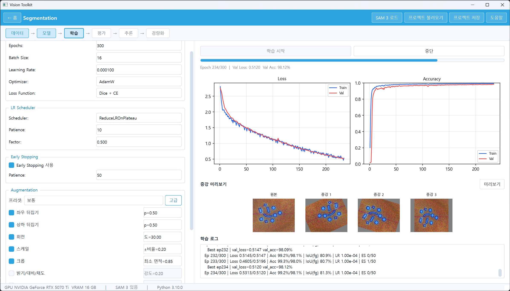
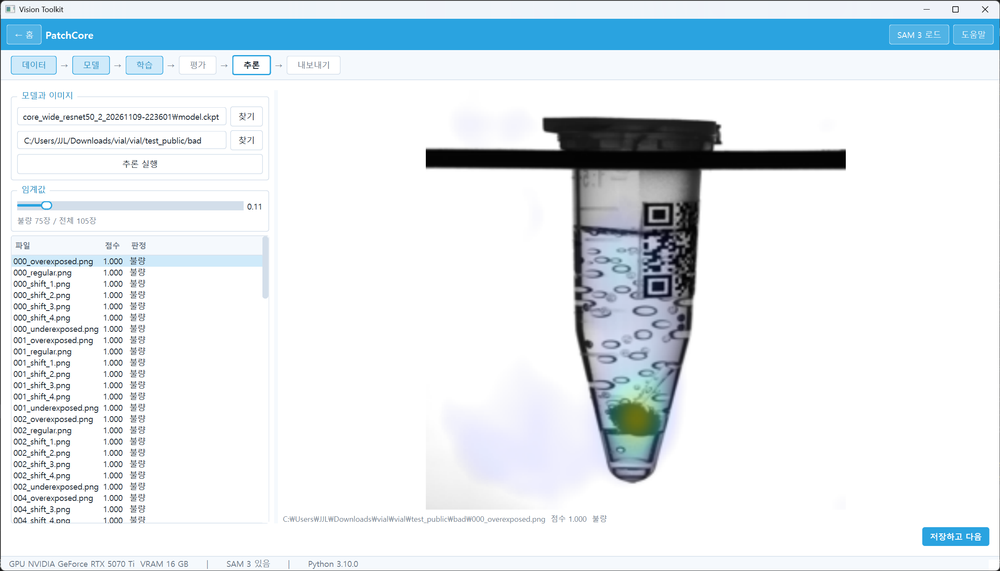

# Lumen app



| 앱 | 하는 일 | 입력 | 결과 |
| --- | --- | --- | --- |
| Labeler | 학습용 라벨 만들기 | 이미지, 초분광 큐브 | 박스 라벨(YOLO 형식), 마스크 PNG |
| HSI Viewer | 초분광 큐브 확인, 스펙트럼 비교 | 초분광 큐브 | 스펙트럼 CSV, 분류 맵 |
| Segmentation | 분할 모델 학습에서 경량화까지 | 이미지와 라벨 폴더 | 학습 모델, 경량화 모델(ONNX), 평가 그림 |
| Object Detection | 객체 검출 모델 학습과 내보내기 | 이미지와 박스 라벨 | PyTorch, ONNX 모델 |
| PatchCore | 정상 이미지만으로 불량 찾기 | 정상 이미지 폴더 | 히트맵, 불량 판정 목록 |

라벨링, 학습, 평가, 추론까지 한 창에서 이어서 하는 비전 도구 모음입니다. Python 3.10 기준입니다.

## 앱 소개

### Labeler

적은 손작업으로 분할과 검출 학습 데이터를 만들기 위한 라벨링 앱.

- SAM 3로 점이나 박스를 몇 번 찍어 영역 마스크 만들기
- 한국어로 대상을 적거나 칸을 비워 두면 VLM(Ollama)이 이미지를 보고 영어 프롬프트를 만들어 SAM 3로 바로 찾기
- 폴더 전체를 글자 프롬프트로 한 번에 자동 라벨링
- 학습한 Segmentation, Object Detection 모델로 새 이미지에 1차 라벨링한 뒤, 점수 낮은 것부터 승인, 수정, 버리기. 고친 라벨로 다시 학습하는 반복에 맞춘 흐름
- 초분광 큐브(mat, npy, hdr, h5, 다채널 tif)를 열어 밴드를 골라 false color로 보며 라벨링, 클래스별 평균 스펙트럼을 CSV로 저장



### HSI Viewer

초분광 큐브를 눈으로 확인하고 물체별 스펙트럼을 뽑아 비교하기 위한 뷰어.

- 큐브를 열어 false color, 단일 밴드, PCA 합성으로 보기
- 이미지 위에 포인트나 ROI를 찍어 스펙트럼을 겹쳐 비교하고 CSV로 저장
- SAM 3에 글자 프롬프트를 주어 물체를 찾고 객체별 스펙트럼 확인
- 찾은 객체를 스펙트럼 특징으로 K개 그룹으로 분류. 방법(KMeans 등)과 객체, 픽셀, ROI 단위를 고를 수 있음
- 결과를 CSV, 라벨 맵(npy), 오버레이 PNG로 저장



### Segmentation

분할 모델을 데이터 준비부터 학습, 평가, 추론, 경량화까지 한 흐름으로 돌리는 앱.

- 이미지와 라벨 폴더를 파일 이름으로 짝지어 불러오고, 폴더 분리, 비율 분리, K-fold 중에서 선택
- UNet 계열, DeepLabV3, SegFormer, TransUNet, DINOv2와 DINOv3 기반 모델, 다채널 초분광 전용 모델 중에서 골라 학습. 증강 미리보기와 조기 종료, 실시간 학습 곡선 제공
- 평가에서 mIoU, F1, Confusion Matrix, PR과 ROC 곡선 등을 골라 저장
- 추론에서 폴더 이미지의 분할 결과와 오버레이 저장. 정답 라벨이 없는 이미지도 가능
- 경량화에서 ONNX로 내보내고 INT8 양자화 후 FP32와 정확도 비교, 민감도 분석으로 양자화에서 뺄 레이어 고르기



### Object Detection

라벨링한 데이터로 객체 검출 모델을 학습하고 평가해 모델 파일로 내보내는 앱.

- YOLOv8, YOLOv10, YOLO11, YOLO12, YOLO26, RT-DETR 중 모델과 크기를 골라 학습
- 폴더 분리, 비율 분리, K-fold, Full Data 학습을 지원하고, K-fold 평균 best epoch로 전체 데이터 학습 가능
- 다채널 TIFF에서 쓸 채널을 고르거나 밴드 3개를 false color로 바꿔 학습과 추론에 사용
- 평가 탭에서 지표와 결과 그림 확인, 폴더 이미지에 추론
- PyTorch, ONNX, INT8 ONNX 형식으로 내보내기

### PatchCore

불량 이미지 없이 정상 이미지만으로 불량을 찾는 이상 탐지 앱.

- 정상 이미지 폴더로 학습. 백본(WideResNet50, ResNet18, ResNet34, ResNet50, ResNeXt50), 사용할 층, coreset 비율, 입력 크기 선택. 학습 중간에 멈출 수 있음
- 정상과 불량이 섞인 테스트 폴더로 이미지 AUROC, 점수 분포, 픽셀 AUROC(마스크가 있을 때) 확인
- F1이 가장 높은 임계값을 자동으로 제안
- 폴더 이미지에 히트맵을 겹쳐 보고 임계값 슬라이더로 불량 판정 목록 만들기
- ONNX로 내보내기



Sample images: MVTec AD 2 (Vial), Heckler-Kram et al., IJCV 2026.
Licensed under CC BY-NC-SA 4.0. Heatmap overlays added.

## 설치와 실행

1. Python 3.10을 준비한다.
2. GPU에 맞는 torch, torchvision을 먼저 설치한다 (https://pytorch.org/get-started/locally/).
   - RTX 50 시리즈: cu128 — `pip install torch torchvision --index-url https://download.pytorch.org/whl/cu128`
   - 그 외 NVIDIA GPU: 드라이버에 맞는 빌드(예: cu126)
   - GPU 없이 CPU만: `pip install torch torchvision --index-url https://download.pytorch.org/whl/cpu`
3. CPU판 onnxruntime이 깔려 있으면 먼저 지운다: `pip uninstall onnxruntime`
4. 나머지 패키지를 설치한다: `pip install -r requirements.txt`
5. 실행한다: `python main.py` (홈 화면에서 앱을 고른다)

연구실 PC에서 돌아가는 정확한 버전은 `requirements-lock.txt`에 기록돼 있다 (참고용).

선택 사항: Labeler의 VLM 프롬프트 추천은 [Ollama](https://ollama.com)가 켜져 있어야 한다. 기본 모델은 `gemma4:12b`이고, 서버 주소(`http://localhost:11434`)와 모델 이름은 설정값으로 바꿀 수 있다.

## 모델 가중치와 라이선스

가중치 파일은 저장소에 들어 있지 않다. 각 모델은 만든 곳의 라이선스를 따르므로, 받기 전에 약관을 확인한다.

- SAM 3 (Labeler, HSI Viewer): Meta의 Hugging Face 페이지 https://huggingface.co/facebook/sam3 에서 접근 권한을 신청하고, 승인되면 `sam3.pt`(약 3.4GB)를 받는다. 앱 위쪽의 "SAM 3 로드"로 파일을 고른다. 라이선스는 SAM License.
- DINOv3 (Segmentation의 DINOv3-S, DINOv3-B): 처음 학습할 때 timm이 Hugging Face에서 가중치를 자동으로 내려받는다 (https://huggingface.co/timm). 라이선스는 DINOv3 License. 접근 승인이 필요하면 Hugging Face에 로그인해서 받는다.
- YOLO, RT-DETR: Ultralytics가 처음 쓸 때 사전학습 가중치를 내려받는다. Ultralytics 코드는 AGPL-3.0이다.
- 그 밖의 사전학습 가중치(ImageNet 백본 등)와 VLM 모델도 각각의 라이선스를 따른다.

## 폴더 구조

```
main.py               홈 화면과 앱 실행
assets/               앱에 쓰는 그림
common/               공통 코드 (테마, 설정, 프로젝트 저장, false color)
docs/                 README 이미지
tools/
  labeler/            Labeler
  hsi_viewer/         HSI Viewer
  segmentation/       Segmentation
  yolo/               Object Detection (폴더 이름은 yolo)
  patchcore/          PatchCore
requirements.txt      설치할 패키지
requirements-lock.txt 연구실 PC의 정확한 버전 (참고용)
LICENSE               MIT
```

## 라이선스

이 저장소의 코드는 MIT 라이선스입니다 (`LICENSE`). 사용하는 라이브러리와 모델 가중치는 각각의 라이선스를 따릅니다. README의 MVTec AD 2 샘플 이미지는 CC BY-NC-SA 4.0이라 상업적으로 쓸 수 없습니다.
