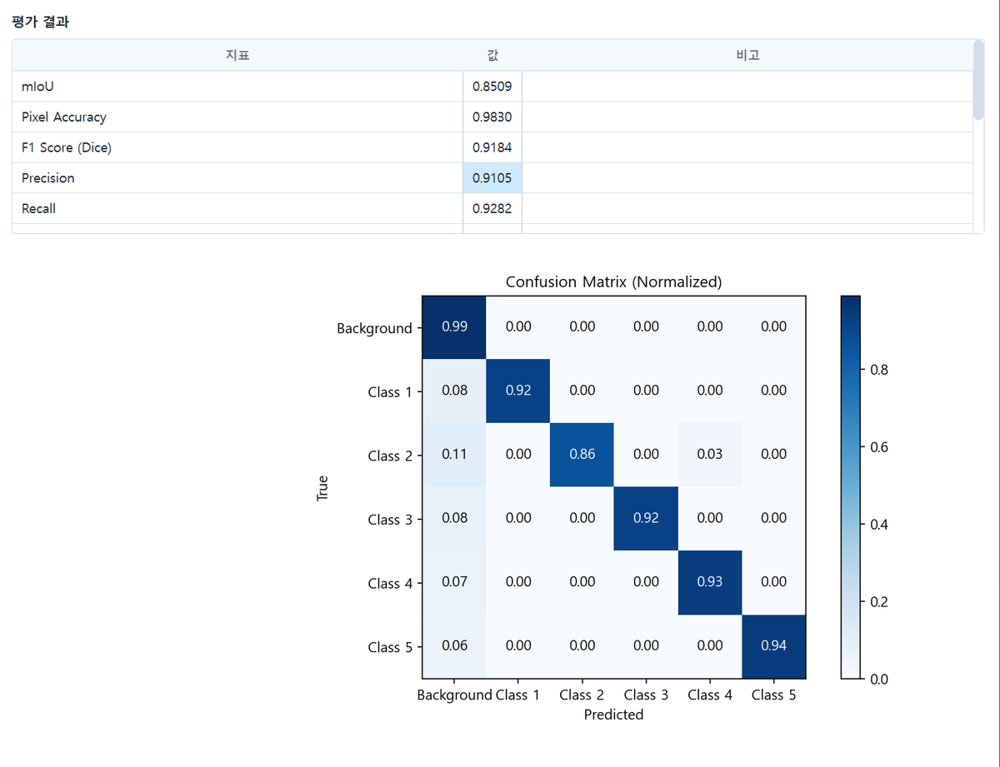
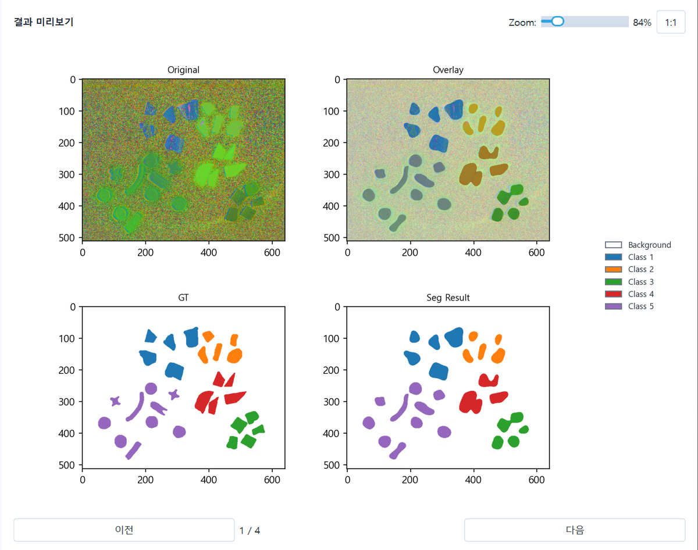

# Spectral Vision Toolkit

PySide6 기반 비전 도구 모음 (Labeler, Segmentation, YOLO, PatchCore, HSI Viewer). Python 3.10 기준.

## 화면

### Labeler
박스/Segmentation 라벨링, SAM 3 보조(점/박스/글자 프롬프트).

### HSI Viewer
초분광 큐브 보기, 스펙트럼, SAM 3 탐지와 클러스터링.

### Segmentation
학습 화면 (Loss/Accuracy 곡선, Augmentation 미리보기).

평가 결과 (mIoU 등 지표, Confusion Matrix).

추론 결과 (Original / Overlay / GT / Seg Result).

### PatchCore
정상 이미지만으로 학습하는 이상 탐지.

Sample images: MVTec AD 2 (Vial), Heckler-Kram et al., IJCV 2026.
Licensed under CC BY-NC-SA 4.0. Heatmap overlays added.

## 설치 순서

1. GPU에 맞는 torch, torchvision을 먼저 설치한다 (https://pytorch.org/get-started/locally/).
   - RTX 50 시리즈: cu128 — `pip install torch torchvision --index-url https://download.pytorch.org/whl/cu128`
   - 그 외 NVIDIA GPU: 드라이버에 맞는 빌드(예: cu126)
   - GPU 없이 CPU만: `pip install torch torchvision --index-url https://download.pytorch.org/whl/cpu`
2. CPU판 onnxruntime이 깔려 있으면 먼저 지우기: `pip uninstall onnxruntime`
3. `pip install -r requirements.txt`

연구실 PC에서 돌아가는 정확한 버전은 `requirements-lock.txt`에 기록돼 있다 (참고용).
